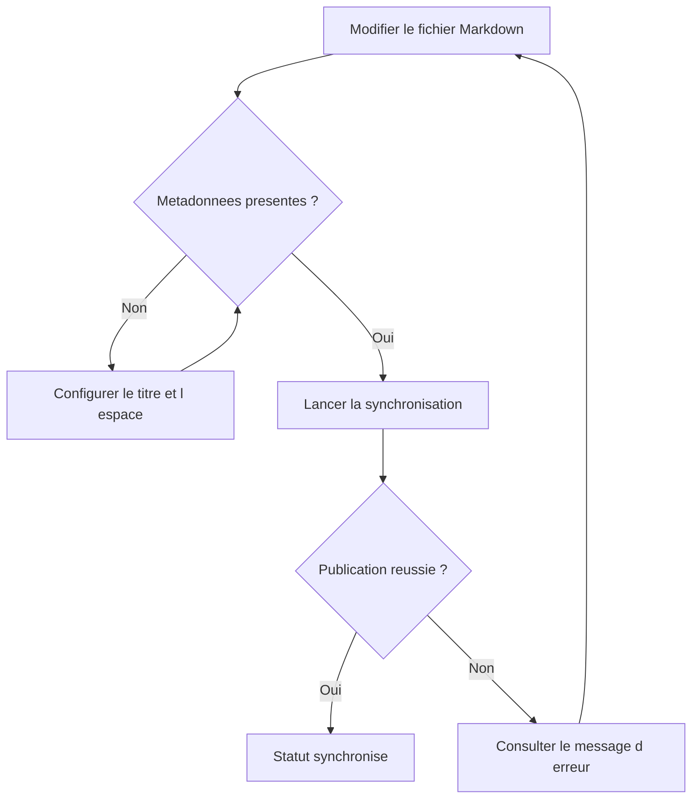
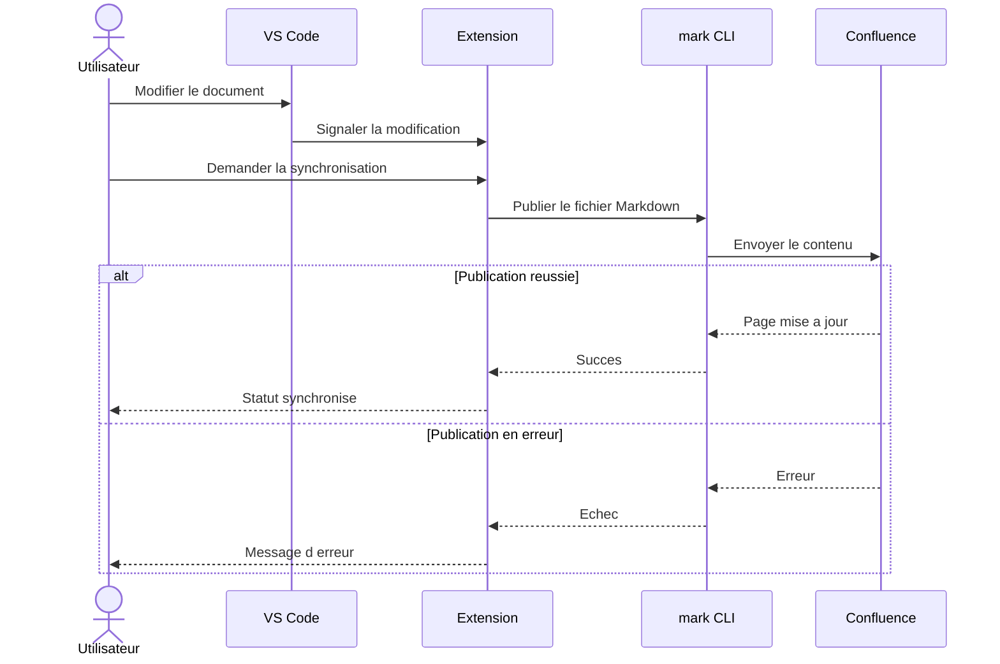
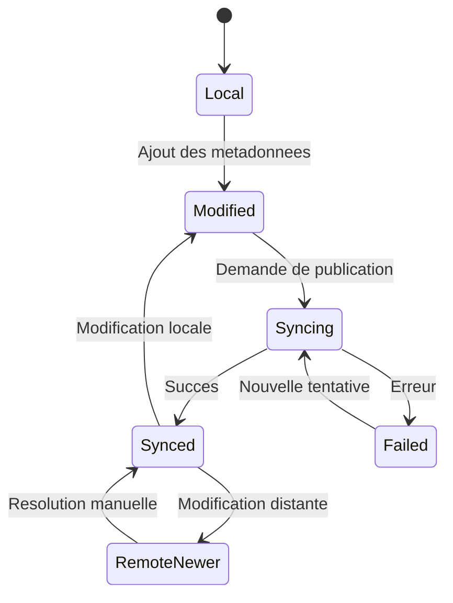
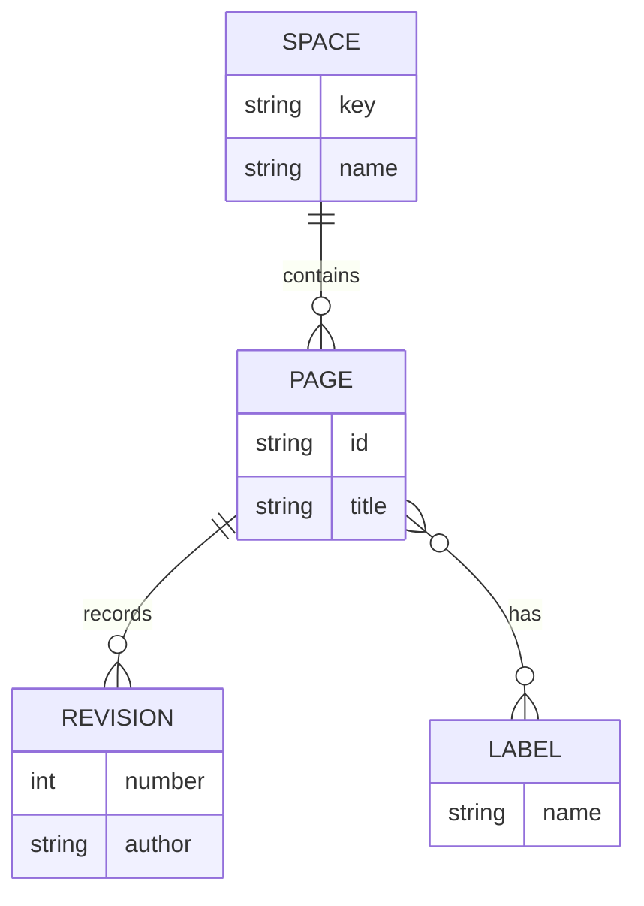

# Test extension - Markdown et Mermaid

Cette page sert de jeu d'essai pour la synchronisation Markdown vers Confluence.
Les donnees sont fictives. Aucun secret n'est inclus dans les exemples.

> L'extension active automatiquement `frontmatter`; ajouter `mermaid` a `vcmd2conf.markFeatures`.
> Le rendu depend des fonctionnalites disponibles dans la version de `mark` utilisee.

## 1. Texte et titres

Texte normal, **texte en gras**, *texte en italique*, ***gras et italique***,
~~texte barre~~ et `code en ligne`.

Caracteres speciaux : & < > " ' et separateurs echappes : \* \_ \[ \].

### Titre de niveau 3

Premier paragraphe pour verifier les espacements.

Second paragraphe avec un [lien externe](https://www.atlassian.com/software/confluence)
et un [lien relatif vers le README](../README.md).

#### Titre de niveau 4

> Une citation simple.
>
> Un second paragraphe dans la meme citation.

---

## 2. Listes et cases a cocher

- Documentation
	- Guide utilisateur
	- Reference technique
- Publication
	- Espace de test
	- Verification du rendu

1. Modifier ce fichier.
2. Lancer la synchronisation depuis l'extension.
3. Comparer le rendu Confluence avec le contenu local.

- [x] Preparer le jeu d'essai.
- [ ] Verifier les diagrammes Mermaid.
- [ ] Verifier les tableaux et les blocs de code.
- [ ] Modifier une phrase et verifier le changement de statut.

## 3. Tableau

| Element | Exemple | Controle attendu |
| :--- | :---: | ---: |
| Texte | **Gras** et *italique* | Lisible |
| Code | `const total = 42;` | Monospace |
| Separateur | `gauche` \| `droite` | Une seule cellule |
| Valeur numerique | 1234.56 | Alignee a droite |

## 4. Blocs de code

### TypeScript

```typescript
interface TestPage {
	title: string;
	labels: string[];
}

const page: TestPage = {
	title: 'Test extension - Markdown et Mermaid',
	labels: ['test-extension', 'markdown'],
};

console.log(`Page de test : ${page.title}`);
```

### JSON

```json
{
	"vcmd2conf.defaultSpace": "VOTRE_ESPACE_TEST",
	"vcmd2conf.markFeatures": "mermaid"
}
```

### Commande shell fictive

```bash
echo "Test Markdown vers Confluence"
```

## 5. Mermaid - Flux de publication



## 6. Mermaid - Diagramme de sequence



## 7. Mermaid - Diagramme d etats

Ce diagramme est un scenario de test simplifie, pas une specification interne.



## 8. Mermaid - Relations entre entites



## 9. Verification manuelle

| Action | Resultat a verifier |
| --- | --- |
| Ouvrir le panneau Confluence Sync | Le fichier apparait avec son titre |
| Publier dans un espace de test | La page est creee ou mise a jour |
| Ouvrir la page Confluence | Les quatre diagrammes sont visibles |
| Comparer le contenu | Titres, listes, liens, tableau et code restent lisibles |
| Modifier une phrase apres publication | Le statut indique une modification locale |
| Publier a nouveau | La meme page est mise a jour |

Phrase a modifier pour le second passage : **version de test 1**.
